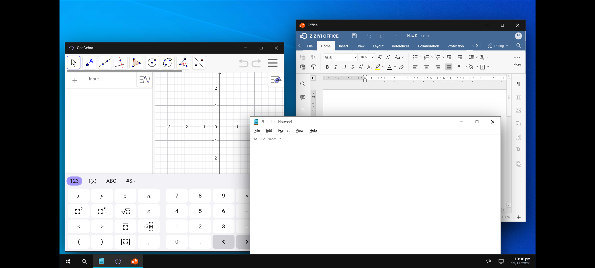
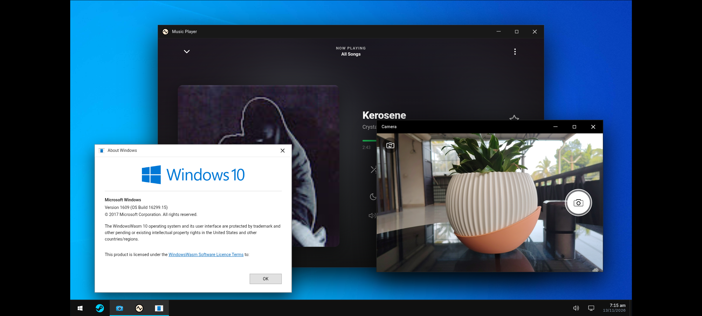
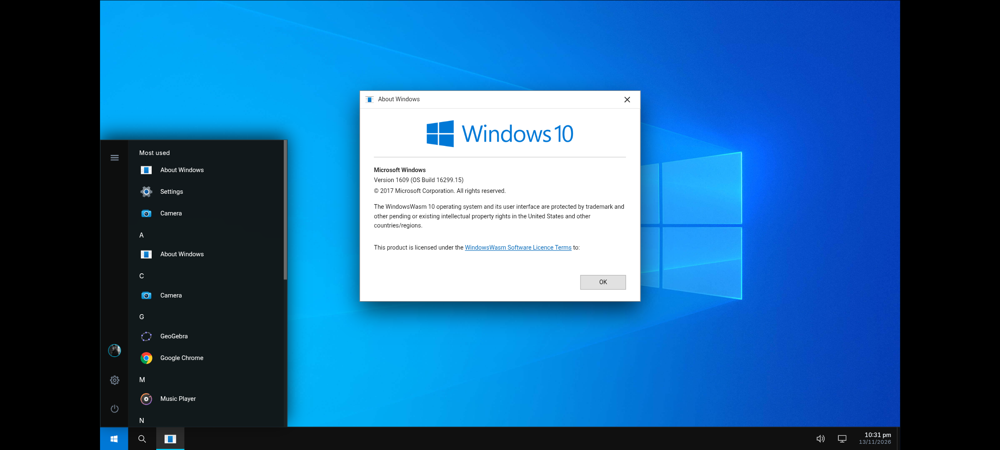

# WindowsWASM

A replica of Windows 10 desktop using HTML, CSS, JAVA in a single file

# Note
WindowWASM is an open source project made in the hope to replicate the Windows 10 desktop experience on web, using standard web technologies like React, CSS, and JavaScript.

This project is licensed under Creative-Commons.

contact: dhananjay.js.online@gmail.com

This project is not in any way affiliated with Microsoft and should not be confused with Microsoft's Operating System or Products.

This is also not Windows 365 cloud PC.

Microsoft, Windows and Other demonstrated Products in this project are trademarks of the Microsoft group of companies

# Pros

- Play any Games In Optimized way

- Play AAA Windows Games ( Future Update)

- No lag, Debloated Version Of Windows 10

- Low Memory Usage

## Screenshots

## To Use

PC Users:https://dhxnxnjxy-dev.github.io/WindowsWASM/

Android Users: See Releases https://github.com/DHXNXNJXY-DEV/WindowsWASM/releases/tag/v.1

